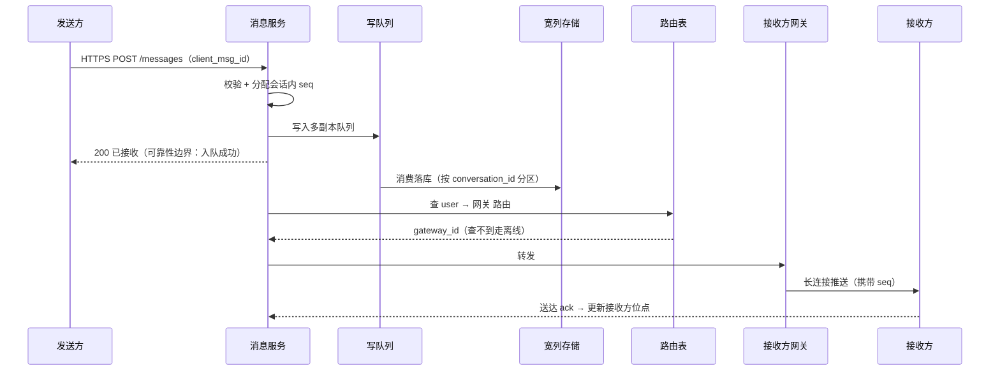

# 即时通讯（Facebook Messenger / WhatsApp）：十亿级在线消息系统

> **TL;DR** — WebSocket 长连接网关负责在线推送，消息按会话分区写进宽列存储；投递语义选 at-least-once，重复靠端侧按 message_id 去重；顺序只承诺"会话内有序"，用会话级单调 seq 在端侧收敛。最关键的取舍是放弃服务端 exactly-once 与全局有序，换来 p99 < 100ms 的写路径和近乎线性的水平扩展。

## 需求与容量估算

- **核心功能**（明确不做的同样重要）：
  - 1对1 文本消息；群聊（默认百人级，万人群在难点里单独讨论）
  - 在线实时推送 + 离线最终投递（上线不漏消息）
  - 送达 / 已读回执；多端间消息状态一致（各端已读位点同步）
  - **不做**（文末延伸讨论）：媒体消息、端到端加密、音视频通话
- **非功能需求**：
  - 规模：500M DAU，100 亿条消息/天
  - 延迟：在线投递 p99 < 100ms（发送到对端可见）
  - 可用性优先：短暂的重复 / 晚到可接受，服务整体不可用不可接受
  - 持久性：服务端确认（ack）之后的消息不能丢——ack 的前提是已落多副本队列
- **容量估算**（推导过程）：
  - 写吞吐：10B 条/天 ÷ 86,400s ≈ **116K msg/s**；按峰值 2~3 倍余量，存储与队列按 **250K~350K msg/s** 设计
  - 存储：200B/条 × 10B = **2TB/天**（原始），三副本约 6TB/天；按一年内流量翻倍估计 ≈ **1.5PB/年**
  - 长连接：500M DAU × 20% 同时在线 ≈ **100M 并发长连接**；单网关节点 10万~100万连接（内存约束），需 **100~1000 个网关节点**
  - 状态放大：每条消息伴随最多 2 次状态更新（送达、已读），状态类写入再乘 2

## 核心难点

<!-- 纪律：只写本场景怎么取舍，共性概念链接 refs，不在此展开 -->

- **在线投递通道怎么选**：100M 并发连接 + p99 < 100ms，轮询类方案（延迟被轮询间隔支配）直接出局；厂商推送延迟秒级、到达率不承诺，只配做离线唤醒，不配做主通道。本场景取舍：WebSocket 长连接为主，APNs/FCM 兜底。通道谱系对比详见 [实时下行通道](../refs/messaging/realtime-channel.md)
- **离线用户怎么保证最终送达**：服务端对发送方的 ack 只承诺"已持久化"，不承诺"对端已见"；接收侧靠 ack + 有限次重试 + 离线收件箱（存储即收件箱，上线按位点拉取）。本场景取舍：at-least-once，把"恰好一次"从服务端承诺里移出去。语义谱系详见 [投递语义](../refs/messaging/delivery-semantics.md)
- **重试必然带来重复，怎么去重**：message_id 由发送端生成（UUID），重试复用同一 id；端侧按 id 做短期 LRU 去重即可，服务端不做逐条查库去重（写路径省一次往返，100ms 预算留给推送）。详见 [幂等与去重](../refs/messaging/idempotency.md)
- **顺序与多端同步**：不承诺全局有序（等于把所有会话序列化到一个点，116K msg/s 不可行），只承诺会话内有序：按 conversation_id 分区路由 + 会话内单调 seq；接收端发现 seq 空洞回源补齐；每端维护各自已确认的连续位点，换端上线从位点续传。方案谱系详见 [消息顺序](../refs/messaging/ordering.md)
- **群聊扩散写还是读**：写扩散延迟好但写放大 ×N——2000 人群一条消息就是 2000 次写，直接打死存储；读扩散写路径 O(1) 但读要聚合。本场景取舍：百人级以下群写扩散（每人收件箱一份），万人群读扩散（存一份、成员拉），分档阈值可配置。判断框架详见 [写扩散 vs 读扩散](../refs/patterns/fan-out.md)
- **消息存哪、存多久**：负载画像是高吞吐 append-only 写 + 按（会话, 消息）点查/范围扫，没有 join 与跨行事务诉求 → 宽列存储（Cassandra 系），以 conversation_id 作分区键、seq 作聚簇键；保留策略用存储原生 TTL 实现（默认永存，用户/群可设自动删除）。存储谱系详见 [宽列存储](../refs/storage/wide-column.md)

## 方案对比

主投递通道：

| 方案 | 优点 | 代价 | 适用条件 |
| ---- | ---- | ---- | -------- |
| WebSocket 长连接 | 服务端主动推、延迟最低；双向；有连接态可做在线状态 | 网关有状态：心跳/重连/路由都要自管；移动端前后台切换断连 | 双向实时、App 前台在线 |
| 长轮询 | 实现简单、HTTP 兼容性完美 | 每条消息一次完整 HTTP 往返；hold 大量挂起请求；峰值惊群 | 低频事件、兼容兜底 |
| SSE | 单向推送实现最简、自带重连语义 | 只能下行；部分代理与移动端环境支持差 | 纯下行、浏览器为主 |
| 厂商推送（APNs/FCM） | 复用系统级长连接，App 被杀可达 | 延迟秒级不可控、payload 小、不承诺送达 | 后台唤醒与角标，不当主通道 |

消息主存储：

| 方案 | 优点 | 代价 | 适用条件 |
| ---- | ---- | ---- | -------- |
| MySQL 分库分表 | 事务、索引、生态成熟 | 写吞吐天花板低；分片键与扩容运维痛苦；TTL 要自建清理 | 量级未到分水岭、团队只养得起 MySQL |
| Cassandra / ScyllaDB | LSM 写吞吐高；哈希分区线性扩展；原生 TTL；CQL 生态 | 无跨行事务；二级索引弱，反查要自建查询表 | 高吞吐写 + 主键读，按会话/实体分区天然 |
| DynamoDB | 全托管、容量弹性 | 按请求计费，350K msg/s 成本敏感；热点分区限流 | 云上托管优先、不想运维存储 |
| Redis（当主存储） | 读写延迟最低 | 1.5PB/年的内存成本不成立；持久化语义弱 | 只做热路径缓存与路由表，不做主存储 |

## 推荐取舍与理由

- **推荐架构**（发送一条消息的流转，落库与推送并行）：

组件职责与边界：

- **接入网关**：只管长连接（握手、心跳、下行推送），不含业务逻辑；userId→gatewayId 路由表放 Redis（带 TTL，心跳续期），网关随时可重启、可水平扩
- **消息服务**：无状态 API。发送走 HTTPS 而不是长连接——请求/响应语义天然带 ack，不用在异步通道上做关联，网关保持"只下行"的简单性
- **写队列 + 存储**：Kafka 削峰解耦，消费写 Cassandra；对发送方的"已送达"回执以落库为准，但 200 响应只承诺入队
- **离线路径**：路由查不到或推送失败 → 消息留在会话分区（存储即收件箱），发一条 FCM/APNs 唤醒；接收端上线按连续位点拉取补齐

- **理由**：
  - **为什么放弃服务端 exactly-once**：服务端逐条查库去重把写路径变成两次往返，p99 < 100ms 的预算被吃掉；重复消息在 UI 层按 message_id 合并的代价约等于零。成本移到端侧是 IM 的正确分工
  - **为什么按 conversation_id 而不是 user_id 分区**：1对1 消息要被双方读，按 user_id 存意味着双写两份（还引入双写一致性）；按会话分区一次写、双方点查
  - **为什么群聊分两档**：写扩散的写放大与群规模线性相关，百人内可接受（×100 写在 LSM 承受范围），万人群必须读扩散保护写路径
  - **为什么顺序只在端侧收敛**：全局有序需要单一序列化点，吞吐被锁死；会话内有序覆盖用户全部可感知体验——没有人跨会话比较消息先后
  - **为什么 ack 的承诺止于"已持久化"**：把"对端可见"拆给回执链路（送达/已读），发送路径不被接收方的网络状况拖住
- **接受的代价**（诚实清单）：
  - seq 空洞补齐前，接收端有短暂乱序窗口
  - 端侧去重窗口外的迟到重试会显示为重复消息，靠会话级 seq 再收敛
  - 路由表（Redis）是推送可用性的关键路径；它抖动时降级为"上线拉取"，消息不丢但实时性下降

## 延伸

- **关联案例**：暂无。TODO：`social-news-feed`（Feed 流）落地时应复用 [写扩散 vs 读扩散](../refs/patterns/fan-out.md) 与 [宽列存储](../refs/storage/wide-column.md)，不要重新展开
- **参考资料**：
  - [systemdesign.io: Design Facebook Messenger or WhatsApp](https://systemdesign.io/question/design-facebook-messenger-or-whatsapp)（本案例起始题目）
  - [Hayk Simonyan: System Design Interview — Design WhatsApp](https://hayksimonyan.substack.com/p/system-design-interview-design-whatsapp)（容量数字的参考来源）
  - [Medium: System Design Chat Application](https://medium.com/@m.romaniiuk/system-design-chat-application-1d6fbf21b372)
  - [Medium: Design a Chat System](https://medium.com/@ishwarya1011.hidkimath/system-design-design-a-chat-system-e0056fb093d1)
  - [YouTube: Chat System Design](https://www.youtube.com/watch?v=-3Ge8EooS3g)
